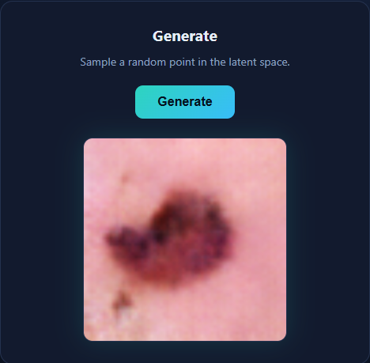
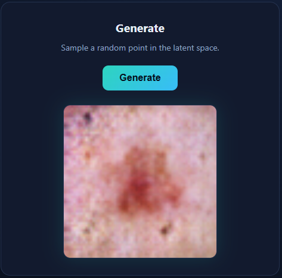
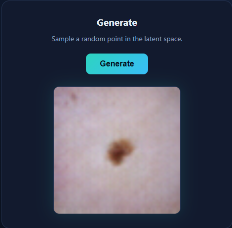
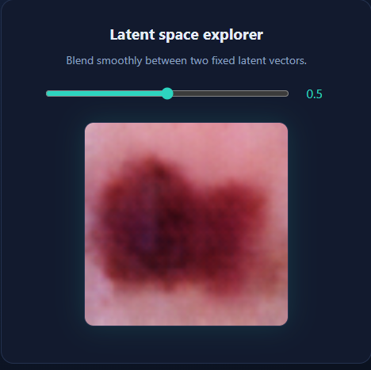

# Synthetic Skin Lesion Generator

I trained a small GAN to generate images of skin lesions, then wrapped it in a web page so anyone can play with it. This is my first real deep learning project, and I built it end to end: looking at the data, training the model, fixing it when it broke, and serving it from an API.

<p>
  
  
  
</p>

These images are fake. They're for learning and experimenting, and nothing here is a medical tool or should be used to diagnose anything.

## What you can do with it

Click **Generate** and the model draws a new lesion from random noise. Every click gives a different one.

The second panel is the part I enjoyed building most. Each image comes from a list of 100 numbers (the latent vector). I fixed two of those lists and added a slider that blends between them. Moving it shows how the generated lesion changes shape and colour a little at a time. It was the first time the "latent space" idea felt real to me.



## How I built it

**The data.** I used DermaMNIST, a set of small dermatoscope images (64×64) with 7 lesion types and 7,007 training images. It's very unbalanced: the largest class has 4,693 images and the two smallest have 80 and 99. I noticed that before training, and it explains why some lesion types are much harder for the model.

**The model.** It's a DCGAN in PyTorch, and you can read it in `model.py`. The training is in `train_gan.ipynb`.

**What went wrong first.** Two things broke, and fixing them taught me more than anything else in the project:
1. The discriminator got too good too fast, so the generator stopped learning. I added label smoothing.
2. Then the generator produced pure noise. I switched to the DCGAN weight initialisation and lesion-like shapes started to appear within about 10 epochs.

I fixed them one after the other, so I didn't know which fix mattered. I tested that afterwards in a small ablation: the initialisation made the biggest difference, and label smoothing mostly kept the discriminator from winning. The details are in [REPORT.md](REPORT.md).

**The API.** `main.py` is a small FastAPI app. It loads the trained generator once when it starts and has two endpoints: `/generate` for a random image and `/interpolate?alpha=0.5` for the slider.

**The page.** It's plain HTML, CSS and JavaScript, with no framework. The page just asks the API for an image and shows it.

## Running it yourself

```
pip install -r requirements.txt
uvicorn main:app --reload
```

Then open `index.html` in your browser, for example with the VS Code Live Server extension. The page only works while the server is running.

## What it can't do (yet)

- The images are small and often blurry. 64×64 doesn't leave much room for detail.
- Rare lesion types look worse because the model saw very few of them.
- Quality is measured with FID on only 2,000 images and one seed per run, so small differences mean little (see the limits in REPORT.md).

## What I want to try next

- Repeat the ablation with several seeds and report the spread.
- Make the generator class-aware, so I can ask for a specific lesion type.

## What's in the repo

| File | What it is |
|---|---|
| `train_gan.ipynb` | training the GAN |
| `explore_data.ipynb` | looking at DermaMNIST and the class imbalance |
| `model.py` | the generator network |
| `main.py` | the FastAPI back-end |
| `index.html`, `style.css` | the web page |
| `ablation.py` | trains the four GAN versions and computes FID |
| `REPORT.md` | the ablation write-up, with results and limits |
| `results/` | sample grids, loss CSVs and the FID summary |