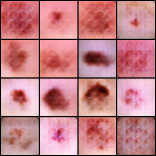
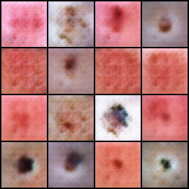
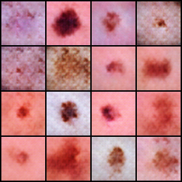
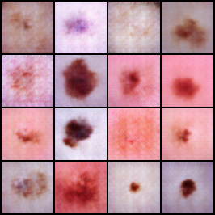

# What actually made my GAN better? A small ablation study

## Question

While training my GAN I ran into two problems. The discriminator got too strong too fast, so the generator couldn't learn anything. And the generator's output looked like noise.

For the first problem I used label smoothing: the target for real images is 0.9 instead of 1.0, which stops the discriminator from becoming overconfident. For the second I used the DCGAN weight initialisation, where weights start as small random values drawn from a normal distribution with mean 0 and standard deviation 0.02, as the DCGAN paper recommends.

I added the fixes one after the other. Label smoothing came first and the output was still noise. Then I added the initialisation and it finally worked. So the final model had both fixes, but I never tested the initialisation alone. I couldn't say which fix mattered, or whether I needed both.

To find out, I trained four versions of the GAN: neither fix, only label smoothing, only the initialisation, and both. Data, seed and every other setting stayed the same. I compared them with FID and sample images.

## Method

The four runs differ in two settings only: the label used for real images (1.0 or 0.9) and whether the DCGAN initialisation is applied.

| Run | Real label | DCGAN init |
|---|---|---|
| baseline | 1.0 | no |
| smoothing | 0.9 | no |
| init | 1.0 | yes |
| both | 0.9 | yes |

Everything else was identical. I used the DermaMNIST training split (7,007 images at 64×64), batch size 64, and the Adam optimiser with learning rate 0.0002 and betas 0.5 and 0.999. Each model trained for 20 epochs with random seed 0 on a laptop CPU, about 21 minutes per run.

I measured quality in three ways. The main one is FID (Fréchet Inception Distance, computed with torchmetrics), where lower means the generated images are closer to the real ones. I compared 2,000 real training images with 2,000 generated ones, with the generator in evaluation mode. I also saved a 4×4 grid of samples from the same fixed noise for each run, so the runs can be compared by eye, and the discriminator and generator losses for every epoch. The code is in `ablation.py`.

## Results

The table shows each model's FID, the number of epochs where the discriminator loss fell below 0.1 (the discriminator was winning almost completely), and the mean generator loss over the last 10 epochs.

| Run | FID (lower is better) | Epochs with D loss < 0.1 | Mean G loss, last 10 epochs |
|---|---|---|---|
| baseline | 154.5 | 5 | 3.02 |
| smoothing | 156.1 | 0 | 5.18 |
| init | 123.8 | 1 | 2.17 |
| both | 118.1 | 0 | 1.87 |

All grids below come from the same noise.

| baseline | smoothing |
|---|---|
|  |  |

| init | both |
|---|---|
|  |  |

## What I see

The initialisation made the biggest difference. FID dropped by about 30 points with it, with or without label smoothing. In the grids, the two runs without it show a repeating grid texture in many images, and the two with it show less of that.

Label smoothing alone did not improve FID: 154.5 for the baseline against 156.1 with smoothing, a gap too small to mean anything. It did change the training, though. In the baseline the discriminator loss fell below 0.1 in 5 of 20 epochs, and with smoothing that never happened, in either run.

Using both gave the best FID (118.1) and the most balanced training, but only a little better than the initialisation alone (123.8). With one seed I can't tell whether that gap is real.

## Limits

I ran each version once, and GAN training varies a lot between runs. In an earlier debugging notebook, the setup I used for the smoothing run gave pure noise, while here it gave blurry blobs that look like lesions. So small FID differences shouldn't be trusted.

Twenty epochs is short, and an FID from 2,000 images is noisy and biased. FID also uses features from a network trained on natural images, not skin lesions, so it may not suit medical images well. The model ignores the lesion class, and the dataset is heavily unbalanced. The grids hold only 16 images each, and my reading of them is subjective.

## Next steps

I want to rerun each version with several seeds and report the mean and spread of FID, train for longer, and try other smoothing values such as 0.8. I'd also like to try resizing followed by a convolution instead of transposed convolutions, to see if that removes the grid texture.